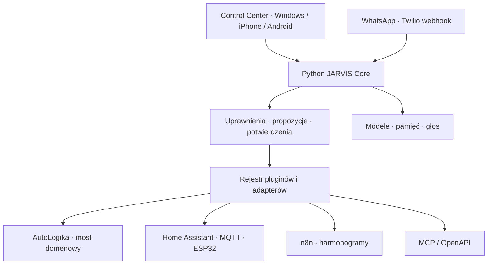

# Docelowa architektura i etapy

Aktualizacja M0.4: obowiązuje [ADR010](adr/0010-master-plan-architecture.md) i nadrzędny plan M0–M8. Poniższe tabele/ADR opisują historyczny punkt wyjścia; React/TS i oddzielny Postgres pozostają celem, a kolejność dawnych wersji nie zastępuje masterplanu.

## Układ systemu

To architektura docelowa. Działające części i przygotowane wyłącznie kontrakty odróżnia tabela poniżej. W MVP Core obsługuje jednego właściciela, SQLite i panel bez builda Node. LLM nie wywołuje narzędzi. Brak automatycznej zmiany kodu serwera.

| Wymaganie | Obecna implementacja 0.4 | Docelowe uzupełnienie / kryterium odbioru |
|---|---|---|
| 1. Core Python | FastAPI, SQLite WAL, walidacja, fabryka aplikacji | Migracje wersjonowane, kolejka zadań, kontrola kosztów i czasów |
| 2. AutoLogika — wszystkie 8 domen | Potwierdzony kontrakt, 8 domen DEMO i czytnik ich kopii SQLite, osobny istniejący GET zleceń | Most usług domenowych: terminarz, zlecenia, pojazdy, części, klienci, finanse, raporty, powiadomienia; parytet z aplikacją i testy konfliktów |
| 3. Rozmowa / modele / pamięć / głos | DEMO/Ollama, katalog modeli, trwała historia sesji, ograniczony kontekst, eksport/retencja; dyktowanie/TTS przeglądarki | Streaming, routing modeli, lokalny faster-whisper oraz Piper po ocenie modelu/licencji, wyszukiwanie semantyczne, retencja |
| 4. WhatsApp / Calling | DEMO oraz podpisany webhook Twilio, inbox, deduplikacja i szkice; brak wysyłki i Calling | Twilio Messaging: podpisy, deduplikacja MessageSid, opt-in, szablony, limity; Calling: weryfikacja konta/numeru, zgody, statusy połączeń, media i agent głosowy |
| 5. HA / ESP32 / MQTT | Symulacje i rzeczywisty czytnik dozwolonych encji HA; brak sterowania i MQTT live | HA REST/WebSocket, MQTT ACL i TLS, ESPHome; najpierw odczyt czujników, potem allowlista świateł, sceny i dopiero zatwierdzona brama z interlockami |
| 6. n8n / proaktywność | Compose opcjonalny, lokalny scheduler, ograniczony token i nieaktywny szablon workflow | Zatwierdzony workflow, poświadczenie o wąskim zakresie, retry/backoff, deduplikacja, strefa Europe/Warsaw, push/WhatsApp z opt-in |
| 7. Pluginy MCP/OpenAPI | Rejestr, konfiguracja, SDK MCP Streamable HTTP, podzbiór OpenAPI GET, sieciowa allowlista i zatwierdzone odczyty | OAuth, stdio w izolacji, pełniejszy OpenAPI, scopes per-plugin, konfiguracja sekretów w vault i zgodność z większą liczbą serwerów |
| 8. Zmiany rozmową | Parser imienia i notatek; zatwierdzanie ustawień/automatyzacji; rollback; propozycja kodu jako opis | Rozmowa tworzy ograniczone DTO, policy engine waliduje; kod: osobna gałąź/worktree → diff → izolowane testy → akceptacja konkretnego hasha → wdrożenie → rollback |
| 9. Control Center | Responsywny panel, 11 widoków, konfiguracja pluginów, tokeny, HA, inbox, audyt i kopie | Edytor konfiguracji i sekretów, role, health per integracja, diagnostyka błędów i test przyłączenia |
| 10. Windows / iPhone / Android | Jeden responsywny interfejs WWW; skrypt Windows i Docker | HTTPS/VPN, testy Safari/Chrome i mikrofonu; PWA opcjonalnie; brak obietnicy stałego nasłuchu w tle na iOS |
| 11. Bezpieczeństwo / operacje | Sekret właściciela, ograniczone tokeny, audyt, SQLite backup+SHA, kopia przed migracją, allowlista sieci, blokady fizycznego sterowania | Wielu użytkowników/scopes/OIDC, vault, rate limit, szyfrowane backupy offsite i restore drill, release signing, skan zależności, monitoring/alerty |

## ADR 001 — lokalny rdzeń i jeden właściciel

Wybór: FastAPI + SQLite + mały panel JS. Bez kosztu hostingu i z prostą instalacją. Klucz właściciela daje pełne uprawnienia. W 0.3 oddzielne tokeny usług mają ograniczone zakresy, datę ważności i cofnięcie; nie zastępuje to kont wielu użytkowników. Przed dostępem współpracowników wdrożyć tożsamości i scopes (owner, workshop-read, workshop-write, home-read, lights-write, sensitive-confirm, automation-admin). Nie wystawiać obecnego MVP bezpośrednio do Internetu.

## ADR 002 — integracja AutoLogiki zgodna z kodem

Electron IPC nie jest sieciowym API. Wykorzystujemy wyłącznie istniejące GET-y serwera mobilnego, ze świadomą konfiguracją. Nie zapisujemy do produkcyjnej bazy i nie kopiujemy całego backendu do JARVIS-a. Brakujące operacje wymagają zaakceptowanej zmiany w AutoLogice w przyszłym etapie. Odczyt z chmury możliwy później przez sync_records z RLS, lecz nie zastępuje logiki domenowej.

## ADR 003 — granice zaufania i urządzenia

Tekst klienta, treści internetu, wynik modelu i opis pluginu są niezaufanymi danymi. Nie mogą zmieniać uprawnień ani potwierdzać własnych działań. Docelowe wrażliwe akcje wymagają challenge z TTL, pojedynczego użycia, powiązania z właścicielem i hashem konkretnej akcji; audyt request/approve/execute/result. Potwierdzenie słowem w rozmowie nie jest wystarczające. Lokalny STOP, fotokomórki, czujnik stanu bramy i timeout pozostają niezależne od modelu. W 0.4 nie ma wbudowanego wykonania fizycznego, nawet po akceptacji propozycji.

## ADR 004 — plugin to nie pobrany kod

Manifest jest opisem, nie źródłem uprawnień. W 0.3 MCP i podzbiór OpenAPI mają działające transporty odczytu; 501 oznacza brak konfiguracji. Właściciel zatwierdza konkretne odczyty, a polityka sieci przypina zweryfikowany adres IP. Zdalne adnotacje nie przyznają uprawnień. Docelowo: manifest z digestem, wersją, transportem, scopes, katalogiem narzędzi i ryzykiem ocenionym przez Core. Instalacja zaufanej integracji i przyznanie jej scopes to osobne kroki. Wyłączenie musi zatrzymać przyszłe zadania, a wykonanie zawsze ponownie sprawdzać uprawnienia. Niedopuszczalne automatyczne `pip install`, shell ani dowolny URL z rozmowy.

## ADR 005 — koszty i licencje

Preferowane komponenty: FastAPI, SQLite, Ollama, Home Assistant, ESPHome i Mosquitto. n8n jest rozwiązaniem source-available/fair-code; nie traktować go bezwarunkowo jako OSI open source. Sprawdzić aktualne warunki przed sprzedażą/hostowaniem usługi. Modele językowe i głosowe mają własne licencje. Twilio/Meta i modele chmurowe mogą generować opłaty; nie obiecujemy darmowego WhatsApp Calling. n8n nie jest wymagany do działania lokalnego MVP.

## Kolejność realizacji

1. **0.2 — wykonane:** audyt kodu, Core/panel, rejestr pluginów, syntetyczne domeny, lokalna pamięć, propozycje i testy, czytnik GET AutoLogiki.
2. **0.3 — wykonane:** transporty MCP/OpenAPI do odczytu, konfiguracja, tokeny usług, HA read-only, inbox Twilio i szkice; laboratorium HTTP oraz rozszerzone testy. Windows i prawdziwe konta nadal wymagają testów na miejscu.
3. **0.4 — wykonane:** trwałe sesje, katalog modeli, ograniczony kontekst, eksport i ręczna retencja; most odczytu 8 domen na kopii schematu 18 oraz jawne agregaty warsztatu w rozmowie. Brak zapisów, streamingu i lokalnego STT/TTS; Windows i prawdziwe dane czekają na test.
4. **0.5 — głos, dom i łączność:** streaming, lokalne STT/TTS, HTTPS/VPN i testy telefonów; MQTT/ESPHome i czujniki, potem świadomie dopuszczone światła/sceny. Pełny most zapisów AutoLogiki wymaga odrębnie zaakceptowanej zmiany usług domenowych. Brama dopiero po osobnym potwierdzeniu i testach niezależnych zabezpieczeń sprzętowych.
5. **0.6 — proaktywność i WhatsApp:** test szablonu n8n na zainstalowanej wersji, retry/backoff, powiadomienia push i wysyłka wiadomości z opt-in, kontrolą kosztów i potwierdzeniami.
6. **0.7 — rozszerzone pluginy i zmiany kodu:** OAuth, pełniejszy OpenAPI, izolowane stdio, scopes per-plugin, review/test/deploy/rollback.
7. **0.8 — Calling i utwardzenie:** aktywacja Twilio/Meta, zgody i sesje głosowe, monitoring, backup offsite i restore drill. Produkcja po testach uprawnień i awarii.

Etapy obejmują wszystkie funkcje; sprzęt, konta i zgoda na zmiany AutoLogiki pozostają warunkami integracji produkcyjnej.

## ADR 007 — eskalacja telefoniczna

Wersja 0.6 oddziela deterministyczne reguły dostępności od przyszłej klasyfikacji rozmowy i wykonania transferu. Klasyfikator nie może ominąć grafiku, DND i urlopu. Ocena zwraca kandydaturę do kontaktu, nigdy zgodę właściciela ani wykonane połączenie. Zegar przyjmuje jednoznaczną chwilę, reguły działają w Europe/Warsaw. Aktualizacja ustawień ma rewizję; numery nie trafiają do audytu. Domyślnie brak godzin/numerów i wyłączone przekazywanie.

## ADR 008 — laboratorium recepcji

Przebieg rozmowy jest osobną maszyną stanów, niezależną od osobistego czatu i pamięci. Właściciel steruje scenariuszem testowym; uproszczona klasyfikacja nie jest dopuszczona do produkcyjnej telefonii. Każde zdarzenie ma ID i rewizję, a zapisy są atomowe. Dostępność ponownie weryfikowana przed przyjęciem. Wewnętrzne podsumowanie ma osobne pole, a docelowy adapter klienta nie może zwracać pełnego obiektu właściciela. Jeden przypadek na rozmowę, brak zapisów AutoLogiki i wysyłki.

## ADR 009 — model recepcji jako źródło danych

Ollama otrzymuje ograniczony kontekst bez osobistej pamięci i ustawień. Backend waliduje schemat, źródło cytatów i dosłowne wartości pól; nie jest to dowód poprawnego rozumienia. High pozwala proponować ocenę, inne pewności wymagają doprecyzowania. Pierwsza prośba, dostępność i akceptacja pozostają deterministyczne. Inferencja poza transakcją; zapis z ponowną kontrolą rewizji i aktualnych reguł. Brak narzędzi modelu i brak fallbacku do heurystyki po błędzie.
