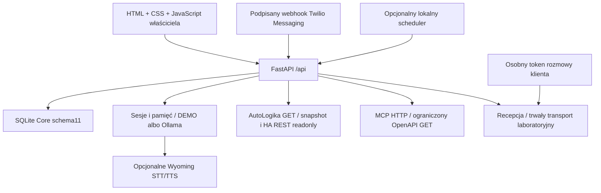

# M0.1 — stan istniejącego JARVIS OS

Data audytu: 2026-10-22 UTC. Zakres: odczyt pełnego planu M0–M8 (45 zadań), instrukcji i istniejącego kodu/dokumentacji. Ten dokument ustala punkt wyjścia; nie nadaje zadaniom statusów ukończenia. Nie zmienia architektury ani nie zastępuje ponownego audytu AutoLogiki w M0.2.

Źródła nadrzędne: [JARVIS_MASTER_PLAN.txt](../../JARVIS_MASTER_PLAN.txt), [dziennik](../../JARVIS_MASTER_PLAN.md), [AGENTS.md](../../AGENTS.md). Odczytano także [00_START_HERE.md](../../00_START_HERE.md), [PROJECT_STATUS.json](../../PROJECT_STATUS.json), [README](../../README.md), [decyzje](../DECISIONS.md), [architekturę](../ARCHITEKTURA.md), [kolejkę historyczną](../NEXT_TASKS.md), [raport](../RAPORT.md), [handoff](../CODEX-HANDOFF.md), [operacje](../OPERACJE.md) i [wcześniejszy audyt AutoLogiki](../AUDYT_AUTOLOGIKA.md).

## Mapa aktualnej architektury

Jest to istniejący modułowy monolit Python, a nie pusty starter. Fabryka `create_app`, inicjalizacja/migracje SQLite, uwierzytelnianie i większość tras są w [jarvis/main.py](../../jarvis/main.py). Core deklaruje wersję 0.8.4 i schemat 11. Kod UI to [index.html](../../jarvis/index.html), [app.js](../../jarvis/app.js), [style.css](../../jarvis/style.css) oraz wydzielone moduły głosu i transportu. W repozytorium JARVIS nie ma aplikacji React/TypeScript, `package.json`, konfiguracji TS ani bundlera. Referencje do React w audycie AutoLogiki opisują inne repozytorium.

## Potwierdzone moduły i granice ich działania

| Obszar | Rzeczywisty kod i zakres | Granica obecnej implementacji |
|---|---|---|
| Core / dane / dostęp | [main.py](../../jarvis/main.py): FastAPI, modele Pydantic, transakcje SQLite, audyt, kopie, migracje; [body_limit.py](../../jarvis/body_limit.py), [network.py](../../jarvis/network.py): ograniczenia body i wybranych połączeń wychodzących | Jeden klucz właściciela oraz hashowane, ograniczone zakresem/czasem i odwoływalne tokeny usług. To nie konta pracowników, role i sesje logowania. API ma ścieżki `/api/...`, bez wersji w ścieżce; `/health` nie bada gotowości zależności. |
| Control Center | [index.html](../../jarvis/index.html) i [app.js](../../jarvis/app.js): 15 pozycji nawigacji, rozmowy, integracje, pamięć, zgody, automatyzacje, warsztat, dom, WhatsApp, laboratoria, tokeny i audyt | Responsywny panel właściciela w zwykłym JS. Brak React/TS, instalowalnego PWA/service workera oraz potwierdzenia pełnego UX na fizycznym iPhone/Android. |
| Rozmowa i modele | [conversations.py](../../jarvis/conversations.py), trasy czatu w [main.py](../../jarvis/main.py): trwałe sesje, historia, eksport/usuwanie/retencja, katalog dozwolonych modeli i ograniczony kontekst; DEMO albo wywołanie Ollamy | Odpowiedź DEMO jest deterministycznym tekstem, nie inferencją. Opcjonalne nazwy modeli Ollamy `:cloud` nie stanowią osobnego adaptera dostawcy cloud z budżetem. Brak ogólnej pętli tool-calling i agenta zadań wieloetapowych. |
| Pamięć | [memory_policy.py](../../jarvis/memory_policy.py), [memory_auto.py](../../jarvis/memory_auto.py), [recall.py](../../jarvis/recall.py): wpisy, źródła, korekty, usuwanie, polityka/rewizje, ograniczona ekstrakcja `pl-declarations-v1`, FTS5 i opcjonalne embeddingi Ollamy | Dane i wektory są w SQLite, bez Postgres/pgvector. Zamknięte polskie deklaracje nie są swobodną ekstrakcją dowolnych faktów. Podział trybów rozmowy nie jest wielodostępną izolacją warsztatów przez RLS. |
| Głos | [voice.py](../../jarvis/voice.py), [audio_sessions.py](../../jarvis/audio_sessions.py), [pcm_capture.js](../../jarvis/pcm_capture.js), [audio_conversation.js](../../jarvis/audio_conversation.js), [voice_panel.js](../../jarvis/voice_panel.js): ręczny mikrofon/PCM, Wyoming STT/TTS, review transkrypcji, oddzielny czat voice i sprzątanie zasobów | Półdupleks uruchamiany ręcznie. Brak wake-word, głosowego barge-in, stałego nasłuchu, pełnego dupleksu i telefonicznego transportu audio. Kod protokołu nie dowodzi jakości modelu/sprzętu. |
| AutoLogika | [autologika.py](../../jarvis/autologika.py): opcjonalny odczyt dwóch wcześniej zidentyfikowanych GET-ów zleceń; [workshop.py](../../jarvis/workshop.py) i [import_autologika.py](../../scripts/import_autologika.py): odczyt osobnej kopii schema18 z manifestem/SHA-256 dla 8 domen | Kopia jest offline, nie synchronizacją. Raporty/finanse/powiadomienia to jawny podzbiór reguł; wkład nie jest zyskiem księgowym. Brak zapisu do AutoLogiki, pełnego API diagnostyki/QC i parytetu domen. Aktualność wcześniejszego kontraktu wymaga M0.2. |
| Dom / urządzenia | [home.py](../../jarvis/home.py): opcjonalny REST GET stanów Home Assistant z allowlistą encji; [main.py](../../jarvis/main.py): jawne syntetyczne odczyty DEMO | Brak HA WebSocket, usług sterujących światłem, MQTT/Mosquitto/ESPHome/ESP32 i reconnectu. Brak kompletnego symulatora bramy ze stanami, interlockami i challenge; sama odmowa sterowania go nie zastępuje. |
| Pluginy | [plugins.py](../../jarvis/plugins.py) i trasy w [main.py](../../jarvis/main.py): rejestracja manifestu, konfiguracja, enable/disable, odkrywanie i ręczne wywołanie sprawdzonych odczytów, MCP Streamable HTTP i podzbiór OpenAPI GET | Manifest nie instaluje kodu. Brak dowolnego wykonywania pluginów, MCP stdio, OAuth i kontrolowanych zapisów; brak integracji narzędzi z pętlą LLM. |
| Automatyzacje / zmiany | [main.py](../../jarvis/main.py): ograniczone propozycje ustawień i interwałowych przypomnień, decyzja i rollback, lokalne powiadomienia; [worker.py](../../jarvis/worker.py): opcjonalny tick; [compose.yaml](../../compose.yaml): opcjonalny profil n8n | Nie jest to pełny system workflow ani kompletna integracja n8n import/eksport/wersjonowanie. Propozycja kodu przechowuje opis i kończy się `review_required`; nie tworzy patcha/brancha/PR ani wdrożenia. |
| WhatsApp | [whatsapp.py](../../jarvis/whatsapp.py) i trasy w [main.py](../../jarvis/main.py): weryfikacja podpisu, inbox, deduplikacja i szkice | Brak wysyłki wiadomości, obsługi głosówek przez kanał WhatsApp, Business Calling i aktywnego konta/operatora. Obecność biblioteki Twilio nie aktywuje tych funkcji. |
| Telefonia / recepcja | [telephony.py](../../jarvis/telephony.py): grafik Europe/Warsaw, wyjątki, DND/urlop i decyzja reguł; [reception.py](../../jarvis/reception.py), [reception_ai.py](../../jarvis/reception_ai.py): laboratoryjne zgłoszenia i opcjonalna analiza strukturalna; [telephony_transport.py](../../jarvis/telephony_transport.py), [telephony_adapter.py](../../jarvis/telephony_adapter.py), [transport_panel.js](../../jarvis/transport_panel.js): trwały outbox, idempotencja/rewizje, osobny token klienta i prywatna decyzja właściciela | Adapter transportu jest czysto laboratoryjny, bez sieci. Klasyfikacja kanału klienta rozpoznaje tylko trzy pełne frazy testowe. Ręczny dispatch; terminy rozliczane przy odczycie/zdarzeniu, bez workera telefonii. Brak PSTN/SIP, webhooków operatora i rzeczywistego mostu audio. |

## Luki względem 45 zadań planu

Poniższe porównanie obejmuje identyfikatory z planu; obecność części kodu nie rozstrzyga odbioru któregokolwiek zadania.

| Zadania | Istniejący punkt wyjścia | Istotne brakujące kryteria / dalsze sprawdzenie |
|---|---|---|
| M0.1–M0.5 | Przejęte repozytorium, niniejszy audyt, wcześniejszy audyt AutoLogiki, ADR w [ARCHITEKTURA.md](../ARCHITEKTURA.md) i decyzje, skrypt Windows | Ponowny audyt aktualnej AutoLogiki, potwierdzenie aktualnych kontraktów i braków, uzgodnienie dawnych ADR SQLite/JS z nowymi wymaganiami Postgres/React, zależności i checklista według nowego planu. |
| M1.1–M1.5 | FastAPI, `.env`, Docker, walidacja, klucz/tokeny, audyt, rejestr odczytów i testy/CI | Wersjonowanie REST, readiness, role/sesje użytkowników/rate limits i docelowa polityka CORS; Postgres/Supabase, migracje i RLS/granty z testami. Obecny SQLite i tokeny usług nie realizują tych wymagań. |
| M2.1–M2.5 | Panel 15 widoków, konfiguracja pluginów, podgląd/akceptacja zmian, kontrolowane testy DOM i wybrane skrypty przeglądarkowe | React/TypeScript i build, kompletne docelowe widoki/statusy, systematyczne testy komponentów i dostępności oraz szersze sprawdzenie mobilne. |
| M3.1–M3.5 | Ollama/DEMO, trwałe sesje, ograniczona pamięć i profile trybu text/voice, korekty i źródła | Oddzielny provider cloud i koszt, bezpieczna pętla narzędzi, Postgres/pgvector, pełne profile/instrukcje/wersjonowanie oraz zadania wieloetapowe i przerwania. |
| M4.1–M4.5 | Dwa GET-y zleceń i czytnik kopii 8 domen; testy syntetycznego kontraktu/snapshotu | Aktualny audyt źródła, pełniejsze odczyty diagnostyki/QC, kontrolowane zapisy notatek/zadań/wycen/statusów, separacja klientów i RLS. Żadnego brakującego endpointu nie można wywnioskować z nazwy domeny DEMO. |
| M5.1–M5.5 | HA REST tylko do odczytu i jawne dane DEMO | HA WebSocket, MQTT/reconnect i firmware, dimming/sceny/harmonogramy/czujniki, kompletny symulator bramy i niezależne potwierdzenie. Adapter fizycznej bramy wymaga inspekcji i osobnej aktywacji. |
| M6.1–M6.5 | Opcjonalny kontener n8n, szablon workflow, lokalne interwały/notyfikacje, zatwierdzane DTO ustawień i rollback | Rzeczywiste workflow n8n i wersjonowanie, scenariusze raportów/urządzeń/alertów, pełny cykl zmiany reguł oraz odizolowany branch/PR/testy dla kodu. |
| M7.1–M7.5 | Wcześniejsze notatki o Twilio, podpisany inbox/szkice, lokalny Wyoming i laboratorium recepcji/transportu | Aktualna kwalifikacja/dokumentacja i koszty Twilio/Meta, wysyłka, głosówki/streaming/interruption/latencja, realne rozmowy i fallback. Laboratorium nie zastępuje kwalifikacji konta ani operatora GSM/SIP. |
| M8.1–M8.5 | Responsywny web, `/health`, Docker healthcheck, lokalna kopia SQLite i kopie przed migracją, skrypty testowe/CI/Windows | PWA i urządzenia mobilne, monitoring/alerty/recovery integracji, pełny restore drill i aktualizacje/rollback, szersze E2E/security oraz skan sekretów. Konfiguracja CI nie dowodzi uruchomienia CI, a instrukcja Windows nie dowodzi testu Windows/WSL2/Dockera. |

## Narzędzia i dowody w repozytorium

- Runtime: Python 3.12, FastAPI/Uvicorn, Pydantic, SQLite; zależności w [requirements.txt](../../requirements.txt), [requirements-dev.txt](../../requirements-dev.txt) i [requirements.lock](../../requirements.lock). Lock nie zawiera hashów pakietów.
- Instalacja i uruchamianie: [cloud_setup.py](../../scripts/cloud_setup.py), [start.ps1](../../scripts/start.ps1), [Dockerfile](../../Dockerfile), [compose.yaml](../../compose.yaml), [.env.example](../../.env.example). Compose udostępnia Core na `127.0.0.1`, n8n i scheduler są opcjonalnymi profilami. Nie ma usług Postgres, MQTT, HA ani modeli w tym Compose.
- Istniejące testy backendu: [tests/](../../tests), w tym migracje, atomowość, scenariusze laboratoryjne, uprawnienia i adaptery. Kontrolowane sprawdzenia UI/audio: `scripts/check_*.cjs`; wybrane opcjonalne przebiegi Chromium: [check_voice_browser.cjs](../../scripts/check_voice_browser.cjs), [check_transport_browser.cjs](../../scripts/check_transport_browser.cjs).
- Ewaluacja recepcji: [reception_eval.py](../../jarvis/reception_eval.py), zestaw syntetyczny i raporty w [docs/evals/](../evals). Walidacja fixture lub kontrolowany HTTP nie jest inferencją prawdziwego modelu.
- CI: [.github/workflows/test.yml](../../.github/workflows/test.yml) definiuje Python 3.12 i Node 22 na Ubuntu/Windows, pytest, pip check, walidację fixture oraz sprawdzenia JS. Obecność workflow nie oznacza, że zewnętrzny job został wykonany.
- Przekazanie: [verify_handoff.py](../../scripts/verify_handoff.py), [package_handoff.py](../../scripts/package_handoff.py), [HANDOFF-MANIFEST.json](../../HANDOFF-MANIFEST.json). Manifest opisuje przekazane bajty; po rozwoju jest historycznym checksumem, nie podpisem ani bieżącym testem regresji.

W tym dokumencie nie dopisano nowych wyników testów. Autor audytu wykonał odczyt plików i przegląd kodu, bez ponownego uruchamiania aplikacji, testów, kont zewnętrznych ani urządzeń. Wyniki ponownej weryfikacji wykonywanej w ramach M0.1 należy zapisać w nadrzędnym dzienniku wraz z rzeczywistymi komendami. Historyczne wyniki w `PROJECT_STATUS.json`/raportach nie stanowią automatycznego zaliczenia nowego planu.

## Granice bezpieczeństwa i rozbieżności dokumentów

1. Prace dotyczą osobnego JARVIS. AutoLogika produkcyjna, jej Supabase i urządzenia pozostają poza uprawnieniami do modyfikacji. Aktualny adapter nie zapisuje danych warsztatu; migawka jest otwierana `mode=ro`, a odczyty mają ograniczenia czasu i stronicowania.
2. Klucz właściciela daje szeroki dostęp i nie może trafić do klienta, pluginu ani webhooka. Token usług jest inny niż token klienta transportu. Publiczna projekcja transportu ma allowlistę, a brief właściciela pozostaje prywatny. Panel laboratorium jest nadal panelem właściciela.
3. Wynik modelu, tekst klienta i manifest pluginu są danymi. LLM nie wykonuje narzędzi. Głosowy czat nie uruchamia parserów poleceń ani automatycznej pamięci. Zmiana kodu w panelu nie uruchamia kodu ani deploya.
4. Dostępność/DND/urlop są ponownie oceniane przy zgodzie i dostarczaniu mostu. Obecny transport dopuszcza najwyżej jedną laboratoryjną próbę; timeout/odmowa/awaria nie uruchamiają ponawiania. Symulowany koszt nie jest limitem rachunku operatora.
5. Nie ma fizycznego sterowania ani realnej wysyłki/Calling. Numer dzwoniącego, WhatsApp i samo polecenie modelu nie są zgodą na bramę. Przyszły adapter zewnętrzny wymaga osobnej aktywacji, uwierzytelnionych webhooków i projektu niezawodnego dostarczania skutków.
6. Sekrety pochodzą z konfiguracji środowiska, nie z manifestu/tekstu modelu. Baza i lokalne backupy nie są szyfrowane przez aplikację; audyt w tej samej SQLite nie jest odporny na administratora pliku. Nie należy wystawiać obecnego MVP bezpośrednio do Internetu.
7. Starsze dokumenty zawierają numery 0.3/0.4, dawne braki głosu i kolejkę R01–R07. Podczas importu poprawiono dawny wpis `00_START_HERE.md` o niedostępnym planie; źródło TXT jest już obecne. Rozstrzygnięcia zakresu i kolejności wynikają z aktualnego planu M0–M8, a opis funkcji z kodu. Zachowanie starszej kolejki nie upoważnia do pominięcia M0.2.

Następną czynnością planu pozostaje M0.2: odczyt aktualnego źródła AutoLogika-OS i aktualizacja dowodów interfejsów, bez zmian w produkcji. Niniejszy audyt nie rozszerza uprawnień do integracji na żywo.
